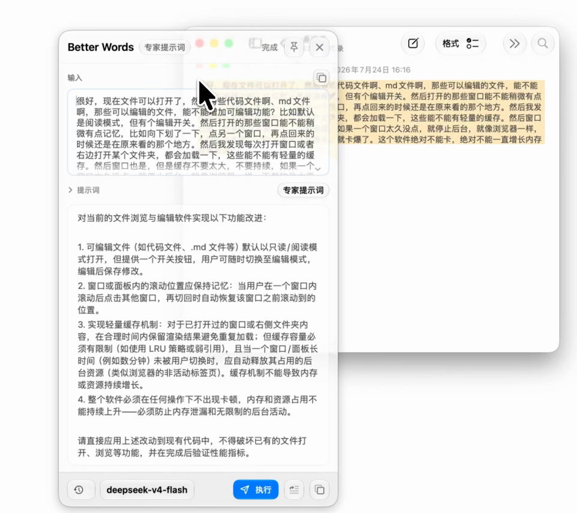
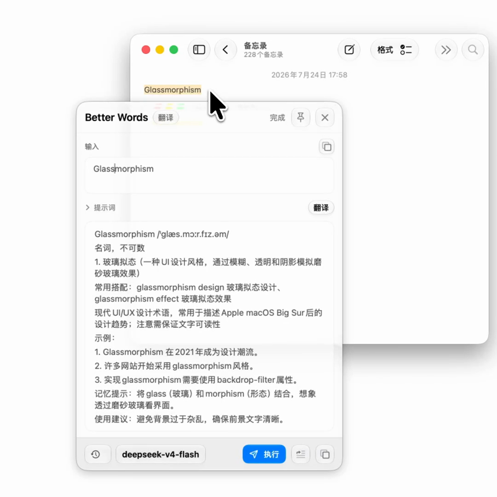
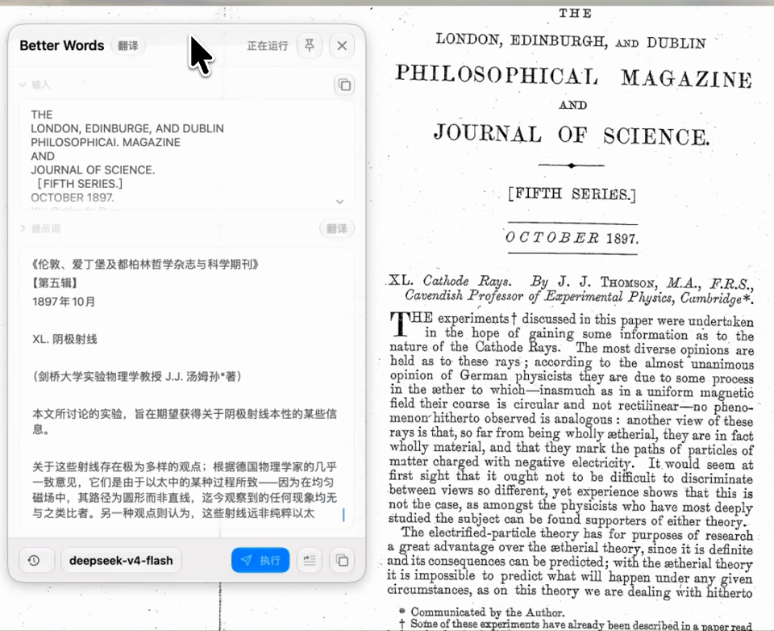
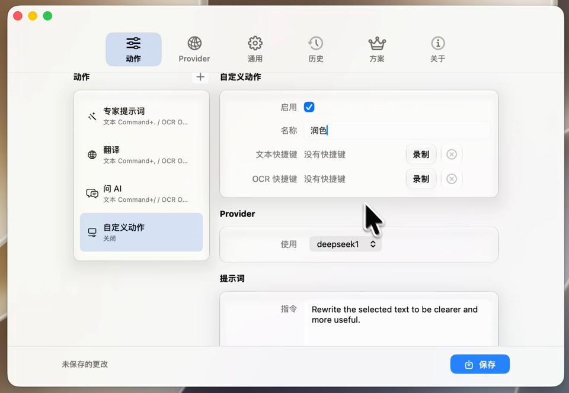
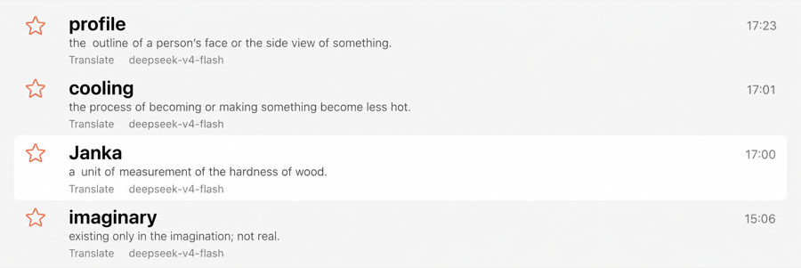
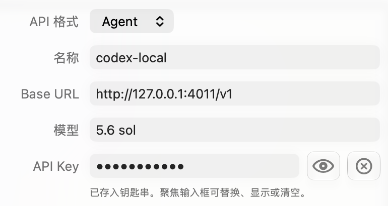

  

<h1 align="center">Better Words</h1>

<strong>선택한 텍스트에 바로 쓰는 macOS용 AI 단축키.</strong>

  사용 중인 앱에서 텍스트를 선택하고 단축키를 누르세요.
  프롬프트를 다듬거나 문단을 번역하고, 직접 만든 지시문도 적용할 수 있습니다.

  <a href="./README.md">English</a> · <a href="./README.zh-CN.md">简体中文</a> · 한국어

  <a href="https://www.uruc.top/betterwords/#download"><strong>macOS용 다운로드</strong></a>
  · <a href="#주요-기능">주요 기능</a>
  · <a href="#피드백">피드백</a>
  · <a href="#데모">데모</a>

macOS 14 이상 · Apple Silicon 및 Intel 지원

텍스트 작업을 실행하려면 Better Words Pro와 연동된 AI 서비스가 필요합니다.

## 주요 기능

### Better Prompt

프롬프트 초안을 선택하고 **Better Prompt**를 실행하세요. 의도와 제약 조건을 유지하면서 AI에 바로 전달할 수 있는 프롬프트로 다듬어 줍니다. 작은 창에서 결과를 편집하거나 복사할 수 있습니다. 편집 가능한 곳에서 텍스트를 선택했다면 원문을 결과로 바꿀 수도 있습니다.

### 번역 및 단어 검색

문장이나 문단을 선택해 번역하세요. 기본 언어 조합은 중국어와 영어입니다. 중국어를 선택하면 영어로, 영어를 선택하면 중국어로 번역합니다. 설정에서 언어 조합을 바꿀 수 있습니다. 단어나 관용구를 선택하면 같은 기능으로 뜻, 확인 가능한 발음, 자주 함께 쓰이는 표현, 번역이 포함된 예문을 볼 수 있습니다.

### 화면 캡처 OCR

스캔한 PDF나 이미지 속 텍스트에 OCR 작업을 실행하려면 먼저 작업을 선택하고 화면에서 필요한 영역을 드래그하세요. Better Words가 Mac에서 텍스트를 인식해 창에 표시한 뒤, 선택한 작업을 실행합니다.

### 사용자 지정 작업과 단축키

이메일 초안 다듬기처럼 자주 쓰는 지시문을 작업으로 저장하세요. 작업 이름과 AI 서비스를 정하고, 선택한 텍스트와 OCR에 각각 단축키를 지정할 수 있습니다. 작업 선택 창을 단축키로 열고 원하는 작업을 그때그때 선택할 수도 있습니다.

### 기록과 즐겨찾기

이전 결과를 검색하거나 작업별로 필터링할 수 있습니다. 다시 보고 싶은 결과는 별표로 표시하세요. 읽다가 처음 본 단어를 즐겨찾기에 모아 두면 나중에 뜻과 예문을 다시 볼 수 있습니다. 기록은 사용자의 Mac에 저장됩니다.

### AI 서비스 연결

클라우드 API, 호환 게이트웨이 또는 호환 엔드포인트를 통해 로컬 에이전트를 연결할 수 있습니다. 작업마다 사용할 AI 서비스를 선택할 수 있습니다. 요청은 설정한 엔드포인트로 전송되며, API 키는 macOS 키체인에 저장됩니다.

## 피드백

Better Words는 소스 코드가 공개되지 않은 앱입니다. 버그나 기능 제안은 [기존 이슈를 검색](https://github.com/waibiwaibig/better-words/issues)하거나 [새 이슈로 등록](https://github.com/waibiwaibig/better-words/issues/new/choose)할 수 있습니다.

GitHub 이슈는 공개됩니다. 예시나 스크린샷을 올리기 전에 API 키, 라이선스 키, 개인 정보를 지워 주세요. 구매와 라이선스 관련 문의는 [URUC 지원팀](https://www.uruc.top/contact)에 보내 주세요.

## 데모

- [Better Prompt로 선택한 텍스트 다듬기](https://www.uruc.top/betterwords/assets/demos/expert-prompt-e40f427d.mp4)
- [문단 번역과 단어 검색](https://www.uruc.top/betterwords/assets/demos/translate-50d1f5ef.mp4)
- [OCR로 스캔 페이지 번역하기](https://www.uruc.top/betterwords/assets/demos/ocr-photo-05b1c2ca.mp4)
- [사용자 지정 작업 만들기](https://www.uruc.top/betterwords/assets/demos/custom-actions-e4ebdebd.mp4)
