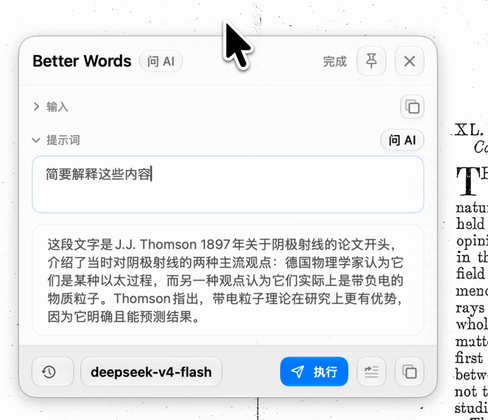
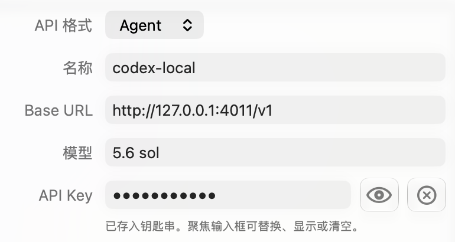

  

<h1 align="center">Better Words</h1>

<strong>AI chat and text shortcuts for macOS.</strong>

  Select text in the app you're using and run an AI action with a shortcut.
  Better Words opens the result in a floating panel.

  <a href="https://www.uruc.top/betterwords/#download"><strong>Download for macOS</strong></a>
  · <a href="#features">Features</a>
  · <a href="#feedback">Give feedback</a>
  · <a href="#demo">Demo</a>

macOS 14 or later · Apple silicon and Intel · Windows coming soon

## Features

### Chat anywhere

Open a chat with a system-wide shortcut. Ask about a passage you're reading or start with a blank question. The response can keep running in the background while you work.

### Translate text and look up words

Translate a sentence or paragraph with the same shortcut you use to look up a word. For individual words, Better Words shows meanings, pronunciation when available, common collocations, and example sentences.

### Turn rough notes into prompts

Expert Prompt rewrites a rough request with clearer instructions and explicit constraints. Review the result in the floating panel, then copy it into the AI tool you use.

### Read text from images with OCR

Drag over a screen region to read text from a scanned PDF, photo, or screenshot. Send the recognized text to Translate, Chat, or another action.

### Create custom actions and shortcuts

Write your own instructions for recurring tasks such as polishing a draft or summarizing a passage. Choose a provider and assign shortcuts for selected text and OCR, or open the action picker with a single shortcut.

### Revisit history and favorites

Open earlier results from history and star useful translations or answers to find them again. History stays on your Mac.

### Connect your own AI provider

Use a supported AI service, a compatible gateway, or a local agent such as Codex. Each action can use a different provider. Requests go to the provider you configure, and API keys are stored in macOS Keychain.

## Feedback

Better Words is a closed-source app. For bugs and feature suggestions, [search existing issues](https://github.com/waibiwaibig/better-words/issues) or [open a new issue](https://github.com/waibiwaibig/better-words/issues/new/choose). 欢迎用中文反馈。

GitHub issues are public. Remove API keys, license keys, and private text from any examples or screenshots. For purchase or license help, [contact URUC support](https://www.uruc.top/contact).

## Demo

- [Chat about a passage](https://www.uruc.top/betterwords/assets/demos/ask-anytime-2eab42f4.mp4)
- [Translate a passage and look up a word](https://www.uruc.top/betterwords/assets/demos/translate-50d1f5ef.mp4)
- [Rewrite a rough prompt](https://www.uruc.top/betterwords/assets/demos/expert-prompt-e40f427d.mp4)
- [Translate a scanned page with OCR](https://www.uruc.top/betterwords/assets/demos/ocr-photo-05b1c2ca.mp4)
- [Create a custom action](https://www.uruc.top/betterwords/assets/demos/custom-actions-e4ebdebd.mp4)
