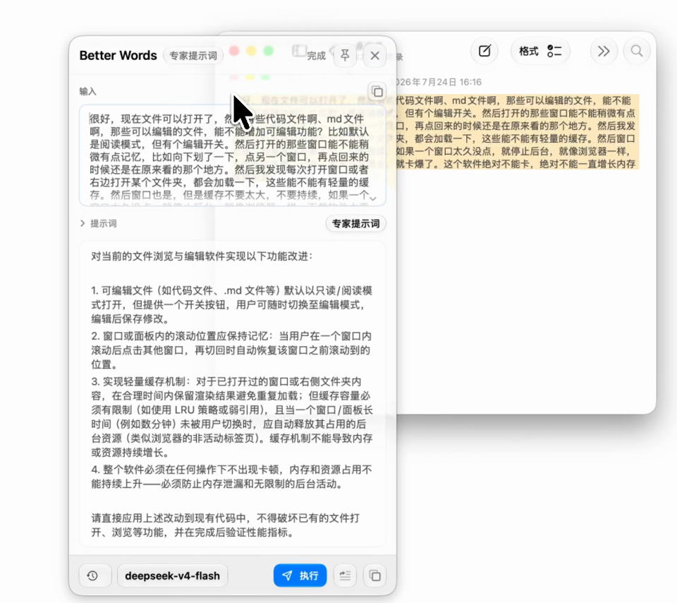
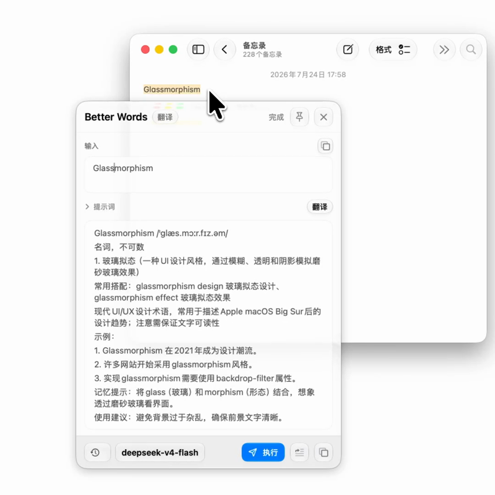
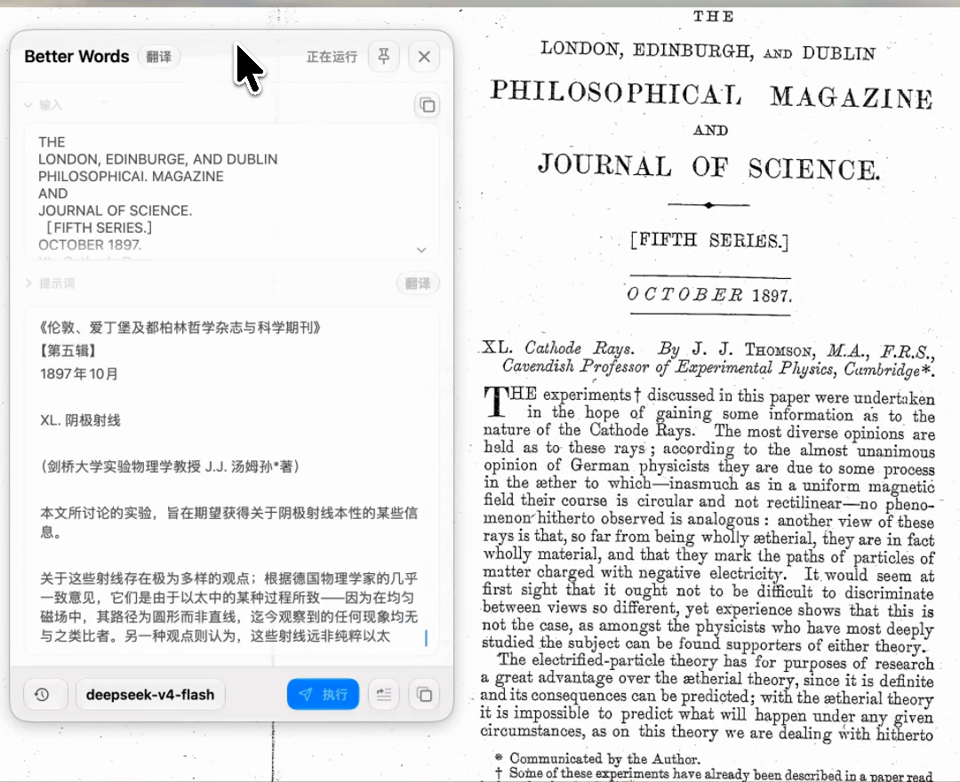
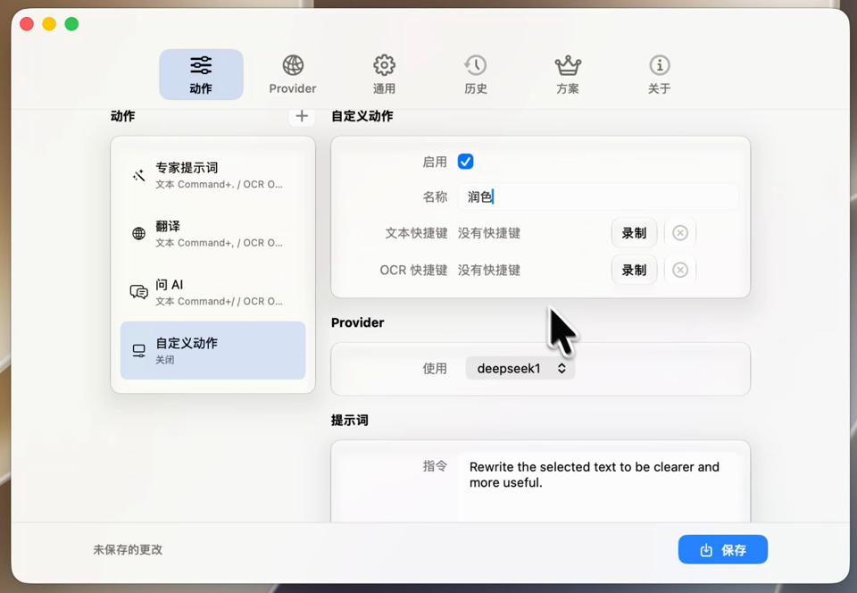
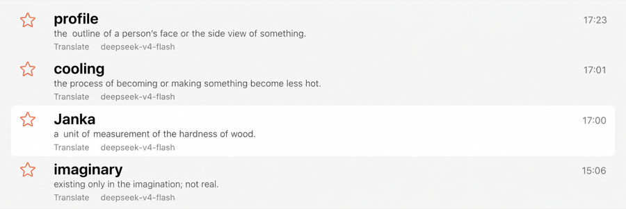

  

<h1 align="center">Better Words</h1>

<strong>AI shortcuts for selected text on macOS.</strong>

  Select text where you're working, then press a shortcut to improve a prompt,
  translate a passage, or apply your own instructions.

  English · <a href="./README.zh-CN.md">简体中文</a> · <a href="./README.ko.md">한국어</a>

  <a href="https://www.uruc.top/betterwords/#download"><strong>Download for macOS</strong></a>
  · <a href="#features">Features</a>
  · <a href="#feedback">Give feedback</a>
  · <a href="#demo">Demo</a>

macOS 14 or later · Apple silicon and Intel

Text actions require Better Words Pro and a configured AI provider.

## Features

### Better Prompt

Select a rough prompt and run **Better Prompt**. It turns your draft into a prompt you can give to another AI, keeping your intent and constraints intact. You can edit the result in the floating panel, copy it, or replace the original text when the selection is editable.

### Translate

Select a sentence or passage for a translation. With the default Chinese–English pair, **Translate** detects which of the two languages you selected and translates into the other. You can change the language pair in Settings. Select a single word or idiom to see its meaning, pronunciation when available, common collocations, and examples with translations.

### Screenshot OCR

When text is embedded in a scanned PDF or image, choose an OCR action and drag over the relevant part of your screen. Better Words recognizes the text on your Mac, shows it in the panel, and runs the action on it.

### Custom actions and shortcuts

Save an instruction you use often, such as polishing an email draft. Give the action a name, choose its AI provider, and set separate shortcuts for selected text and OCR if you need them. You can also set a shortcut that opens the action picker so you can choose what to run.

### History and favorites

Search past results, filter them by action, and star entries you want to revisit. For example, keep new vocabulary in Favorites and reread the explanations later. History stays on your Mac.

### Your AI provider

Connect a cloud API, a compatible gateway, or a local agent through a compatible endpoint. You can choose which provider each action uses. Requests go to that endpoint, and API keys stay in macOS Keychain.

## Feedback

Better Words is a closed-source app. For bugs and feature suggestions, [search existing issues](https://github.com/waibiwaibig/better-words/issues) or [open a new issue](https://github.com/waibiwaibig/better-words/issues/new/choose). 欢迎用中文反馈。

GitHub issues are public. Remove API keys, license keys, and private text from any examples or screenshots. For purchase or license help, [contact URUC support](https://www.uruc.top/contact).

## Demo

- [Better Prompt on selected text](https://www.uruc.top/betterwords/assets/demos/expert-prompt-e40f427d.mp4)
- [Translate a passage and look up a word](https://www.uruc.top/betterwords/assets/demos/translate-50d1f5ef.mp4)
- [Translate a scanned page with OCR](https://www.uruc.top/betterwords/assets/demos/ocr-photo-05b1c2ca.mp4)
- [Create a custom action](https://www.uruc.top/betterwords/assets/demos/custom-actions-e4ebdebd.mp4)
