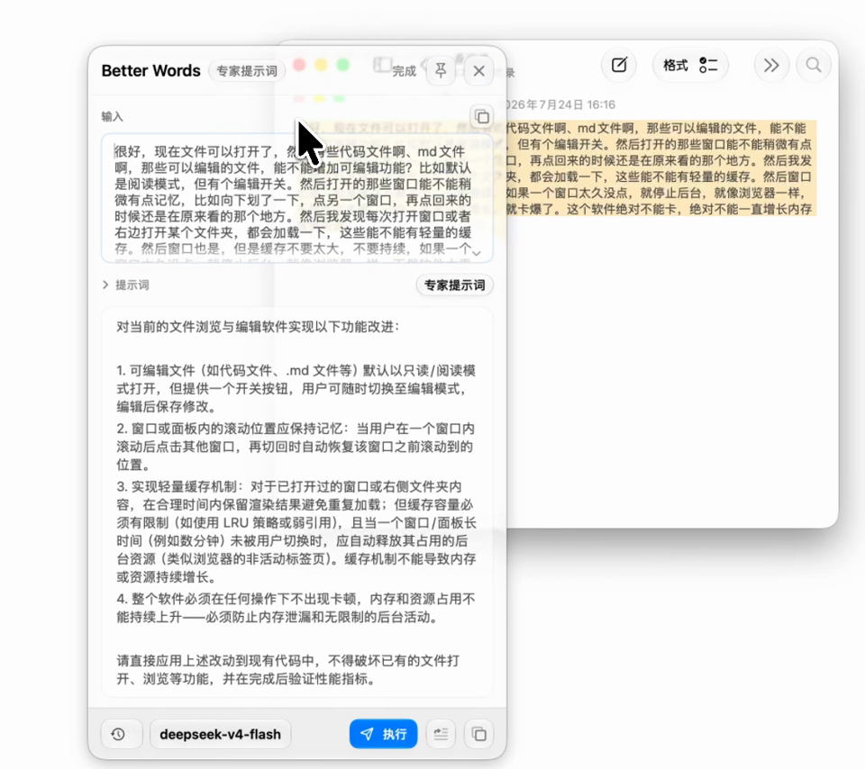
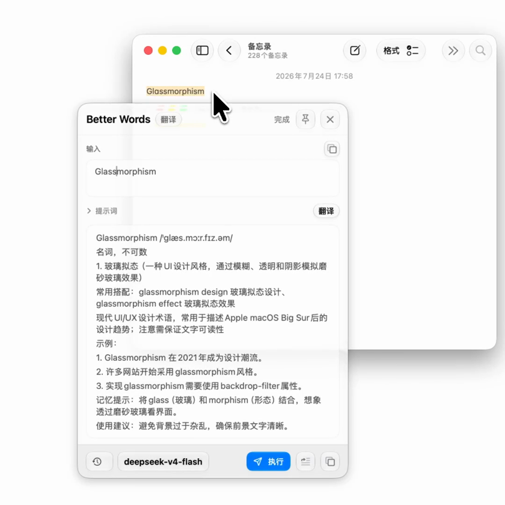
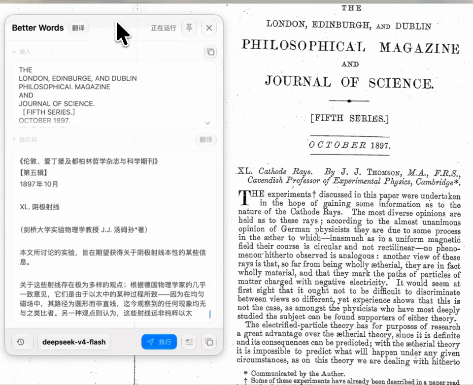
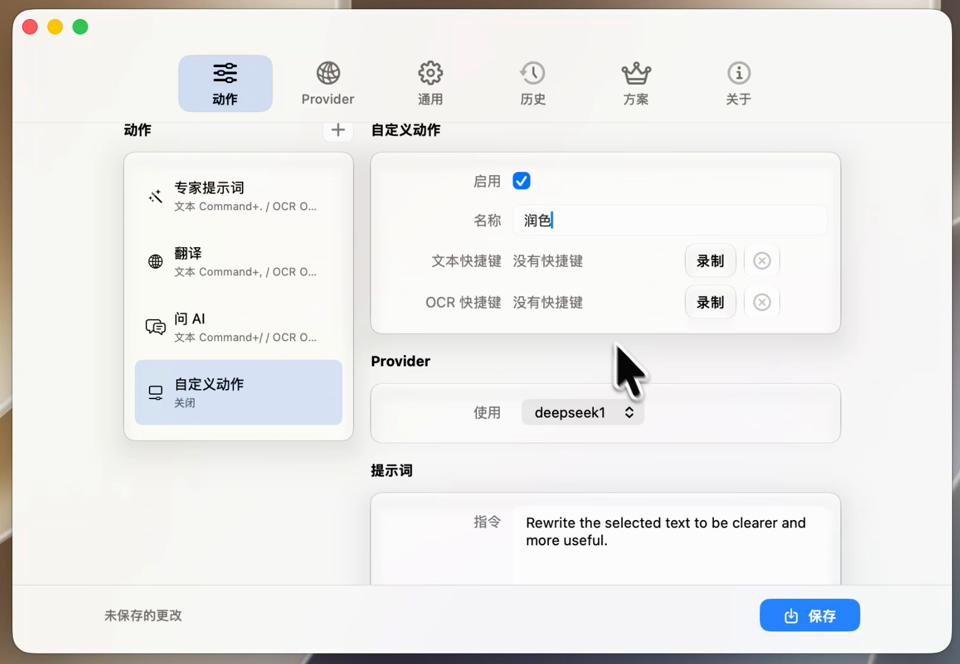
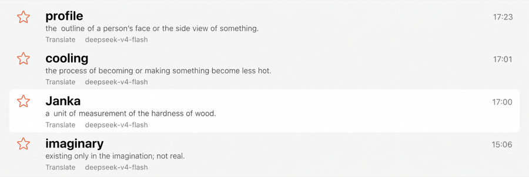
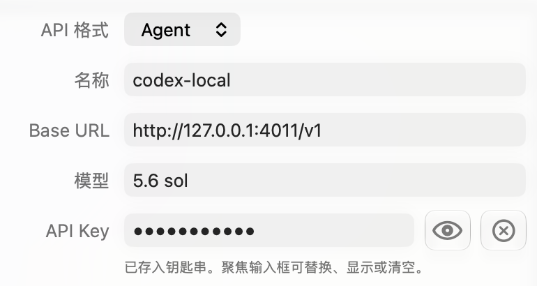

  

<h1 align="center">Better Words</h1>

<strong>在 macOS 上用快捷键处理选中的文字。</strong>

  在当前应用里选中文字，按快捷键就能改写提示词、翻译段落，或执行你自己的指令。

  <a href="./README.md">English</a> · 简体中文 · <a href="./README.ko.md">한국어</a>

  <a href="https://www.uruc.top/betterwords/#download"><strong>下载 macOS 版</strong></a>
  · <a href="#主要功能">主要功能</a>
  · <a href="#反馈">反馈</a>
  · <a href="#演示">演示</a>

macOS 14 或更新版本 · 支持 Apple 芯片和 Intel 芯片

使用文本动作需要 Better Words Pro，并配置自己的 AI 服务。

## 主要功能

### Better Prompt

选中一段粗稿，运行 **Better Prompt**。它保留你的原意和约束，把草稿改写成可以直接交给 AI 的提示词。你可以在浮动面板里编辑或复制结果，也可以直接替换可编辑区域里的选中文字。

### 翻译与查词

选中一句话或一段文字即可翻译。默认使用中英语言对，选中中文就译成英文，选中英文就译成中文。你也可以在设置里更换语言对。选中单词或习语时，同一个动作会给出词义、发音（如有）、常用搭配和带翻译的例句。

### 截图 OCR

遇到扫描版 PDF 或图片里的文字，选择一个 OCR 动作，再框选屏幕上的对应区域。Better Words 会在 Mac 上识别文字，把识别结果显示在面板里，并用它运行所选动作。

### 自定义动作与快捷键

把经常用的指令保存成动作，比如润色邮件草稿。给动作起名、指定 AI 服务，再按需为选中文字和截图 OCR 分别设置快捷键。你也可以设一个快捷键打开动作列表，临时选择要运行的动作。

### 历史与收藏

搜索以前的结果，按动作筛选，把想重看的条目标为收藏。比如读文章时遇到新词，可以收藏，之后再回看释义和例句。历史记录保存在你的 Mac 上。

### 配置自己的 AI 服务

可以连接云端 API、兼容网关，或通过兼容端点接入本地 Agent。每个动作可以用不同的 AI 服务。请求会发往你配置的端点，API 密钥保存在 macOS 钥匙串中。

## 反馈

Better Words 是闭源应用。遇到问题或有功能建议，欢迎用中文[查看已有反馈](https://github.com/waibiwaibig/better-words/issues)或[提交新反馈](https://github.com/waibiwaibig/better-words/issues/new/choose)。

GitHub 上的反馈是公开的。提交示例或截图前，请去掉 API 密钥、授权码和私人内容。购买或授权问题请[联系 URUC 支持](https://www.uruc.top/contact)。

## 演示

- [用 Better Prompt 改写选中的文字](https://www.uruc.top/betterwords/assets/demos/expert-prompt-e40f427d.mp4)
- [翻译段落和查询单词](https://www.uruc.top/betterwords/assets/demos/translate-50d1f5ef.mp4)
- [用截图 OCR 翻译扫描页](https://www.uruc.top/betterwords/assets/demos/ocr-photo-05b1c2ca.mp4)
- [创建自定义动作](https://www.uruc.top/betterwords/assets/demos/custom-actions-e4ebdebd.mp4)
